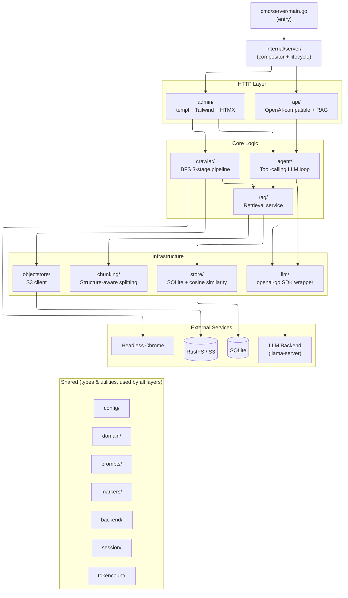
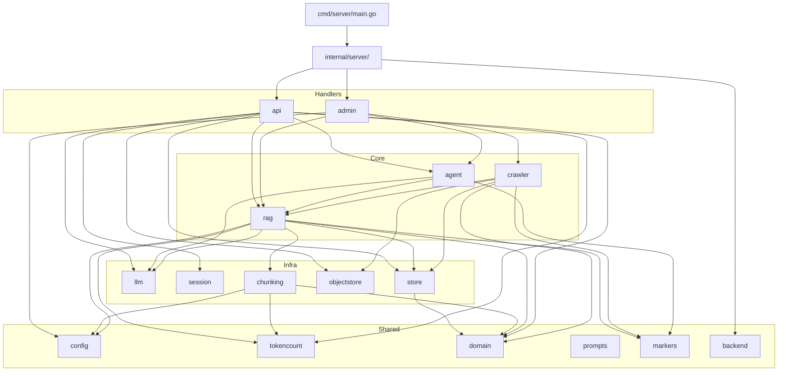
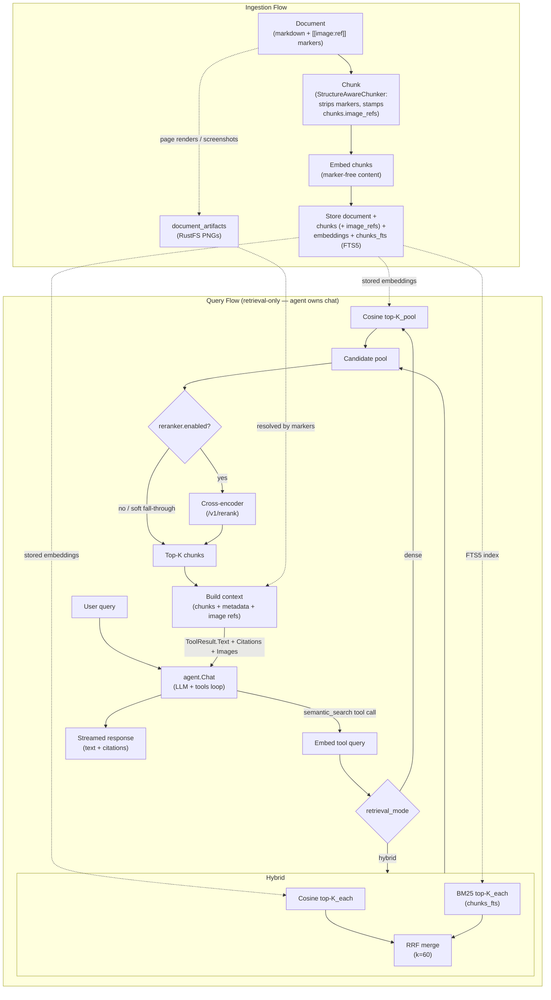
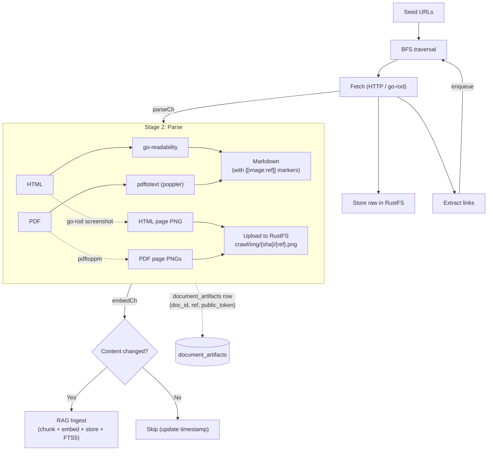
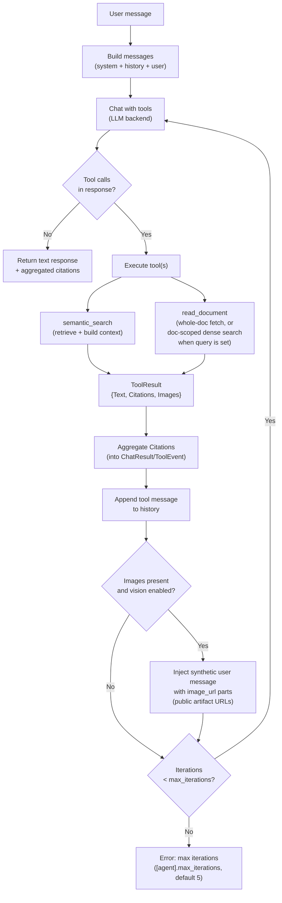
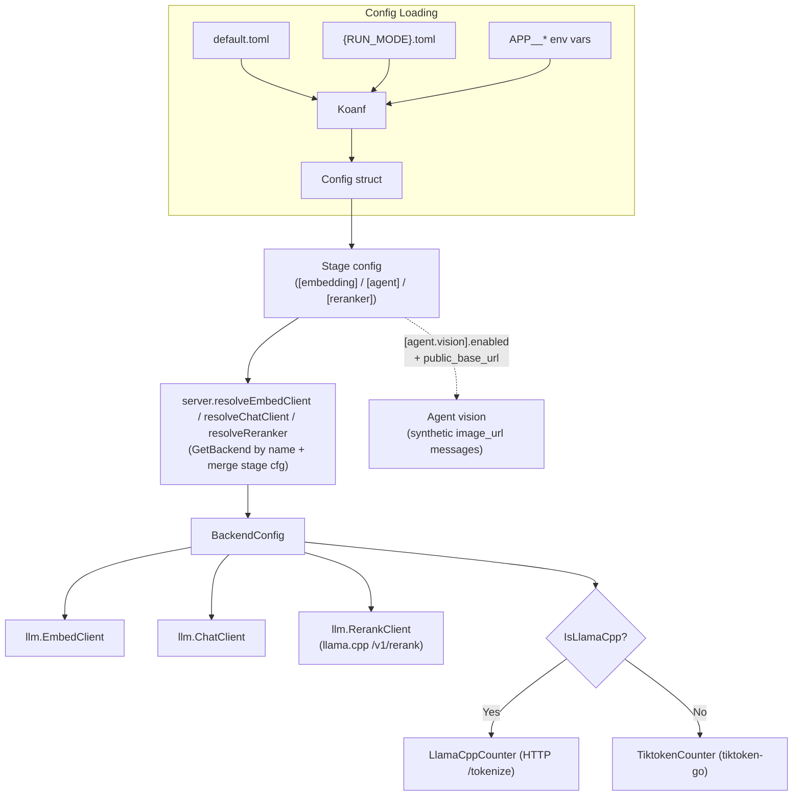
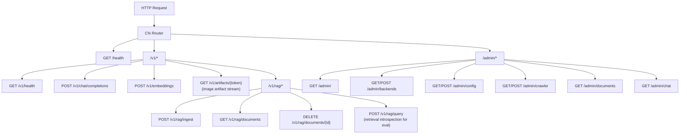
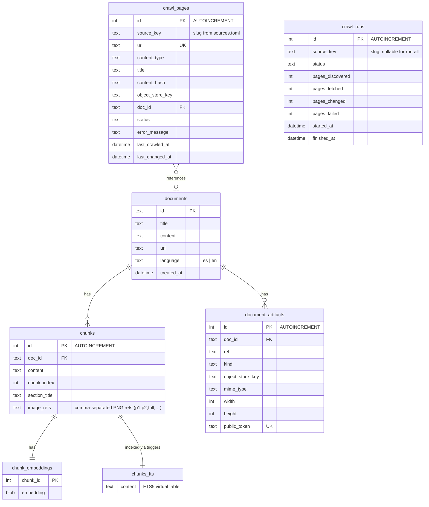

# Architecture Diagrams

## 1. High-Level System Architecture

## 2. Package Dependency Graph

## 3. RAG Pipeline

## 4. Crawler Pipeline (3-Stage)

## 5. Agent Tool-Calling Loop

## 6. Configuration & Client Resolution

## 7. Request Routing

## 8. Storage Schema

Backends and crawl sources are **not stored in SQLite** — they live as `[[backends]]` in `config.toml` and `[[sources]]` in `config/sources.toml` respectively. Both round-trip through admin UI CRUD via `config.WriteTo()` and `config.WriteSources()`. `crawl_pages.source_key` and `crawl_runs.source_key` reference the slug from each `[[sources]]` block, validated against the in-memory snapshot at runtime rather than by SQL FK. The `chunks_fts` virtual table (FTS5 over `chunks.content`, `unicode61 remove_diacritics 2` tokenizer) is kept in sync with `chunks` via INSERT/UPDATE/DELETE triggers and backs the BM25 leg of hybrid retrieval.
