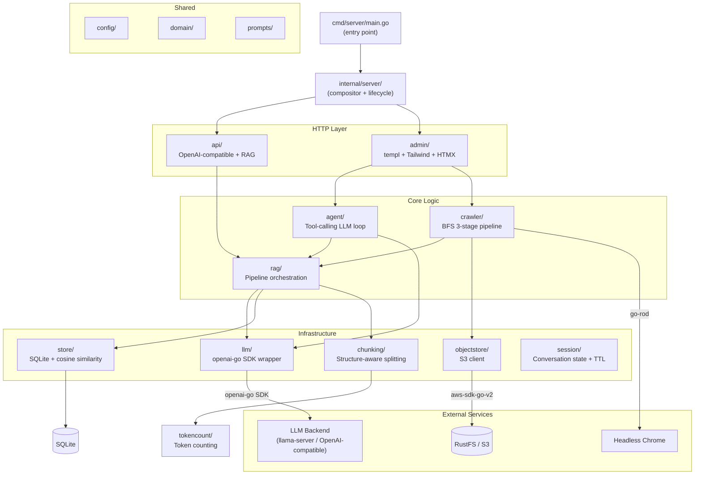
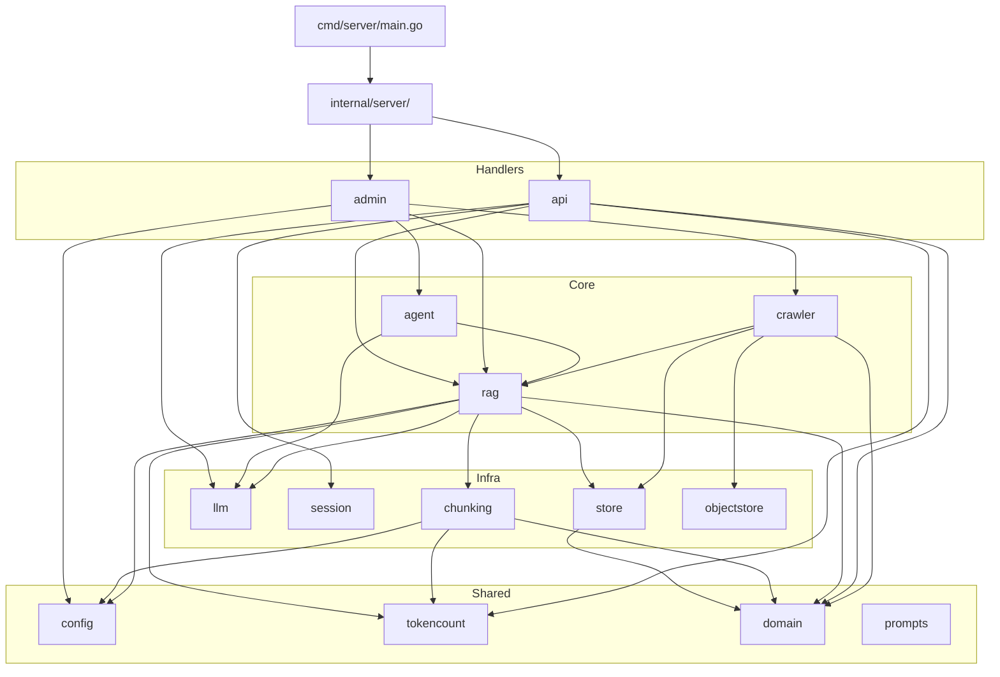
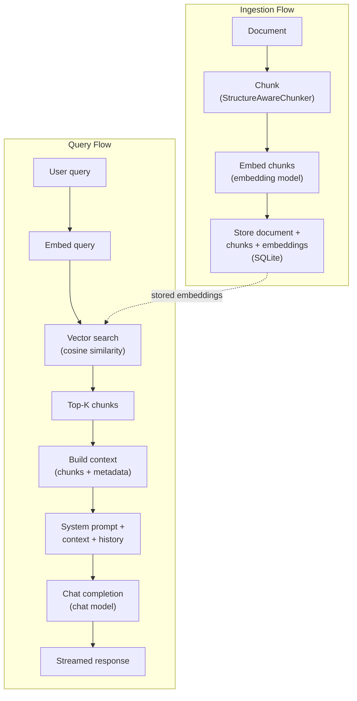
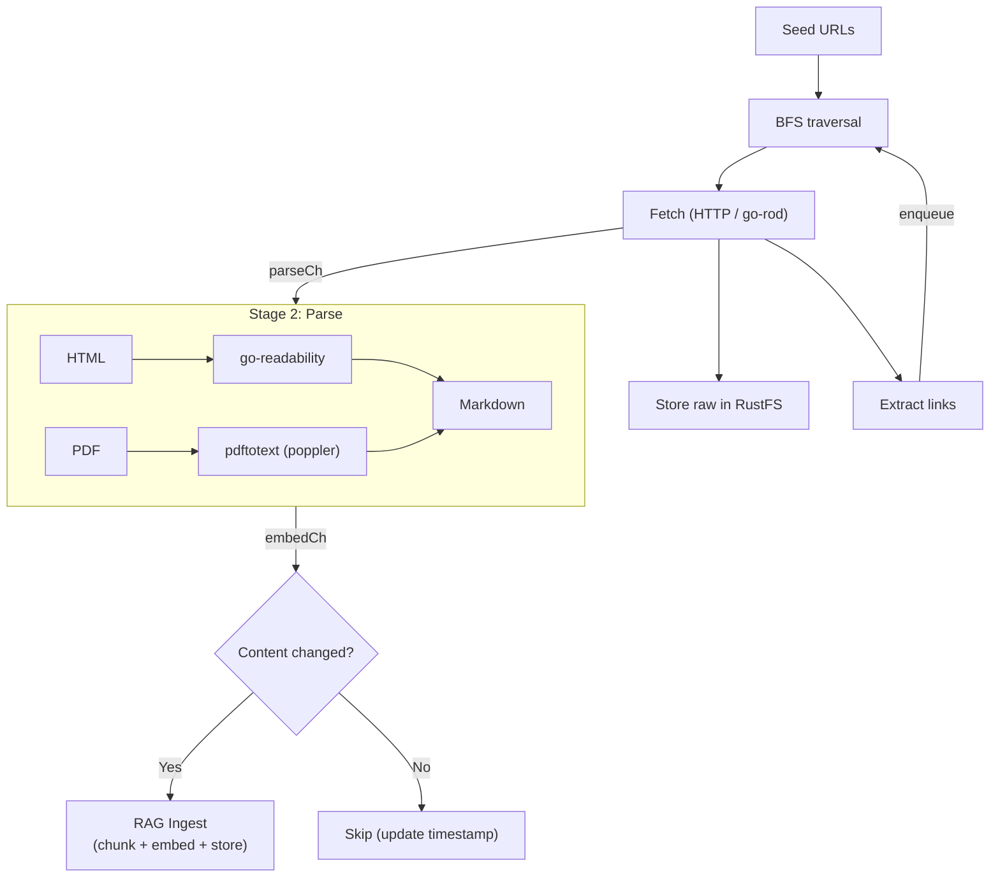
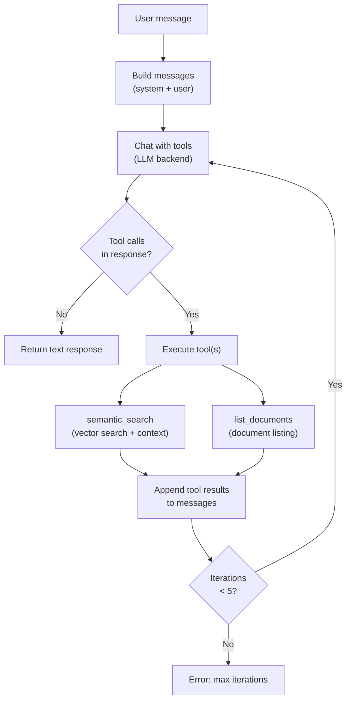
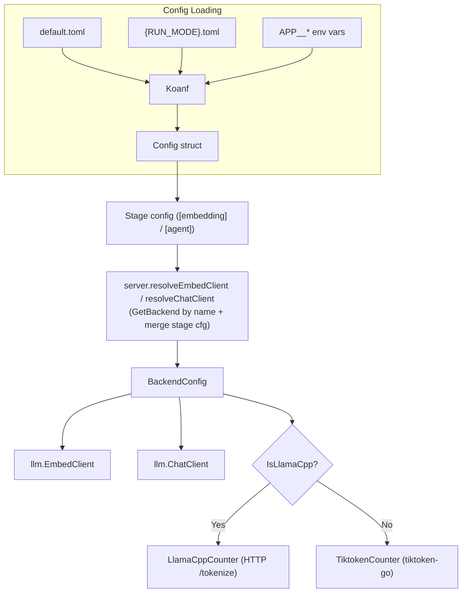
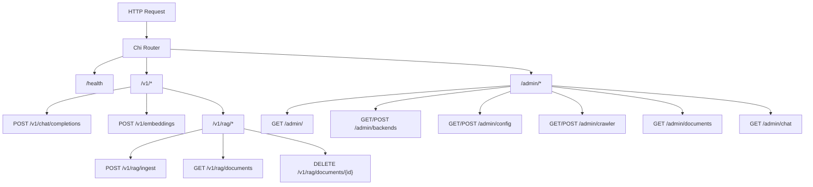
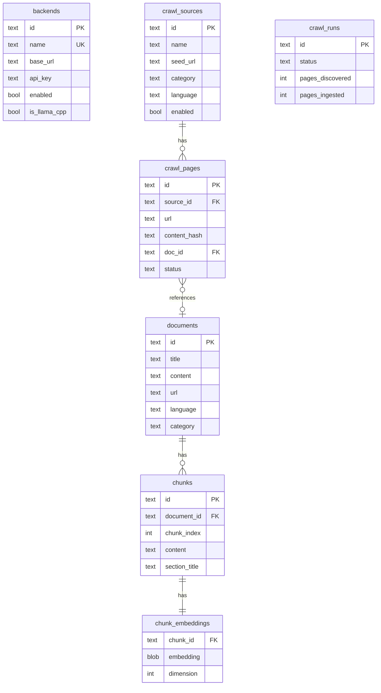

# Architecture Diagrams

## 1. High-Level System Architecture

## 2. Package Dependency Graph

## 3. RAG Pipeline

## 4. Crawler Pipeline (3-Stage)

## 5. Agent Tool-Calling Loop

## 6. Configuration & Client Resolution

## 7. Request Routing

## 8. Storage Schema

